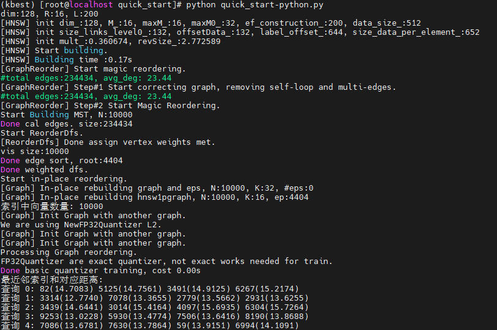
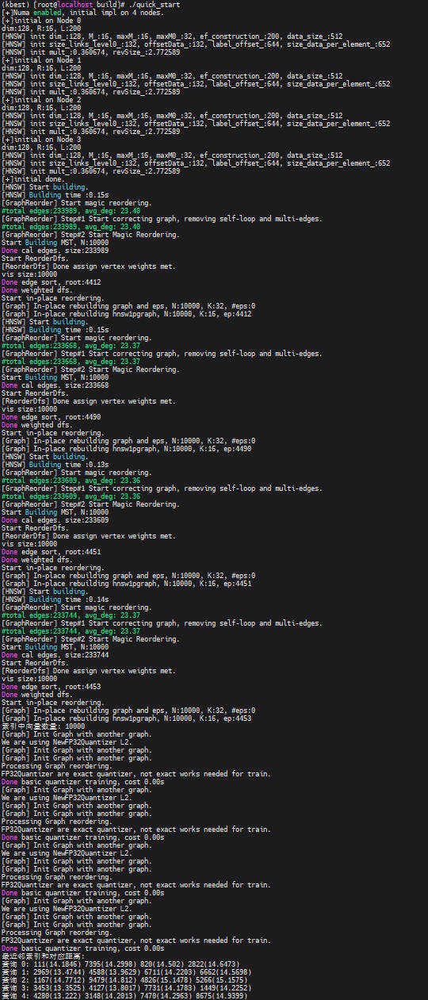
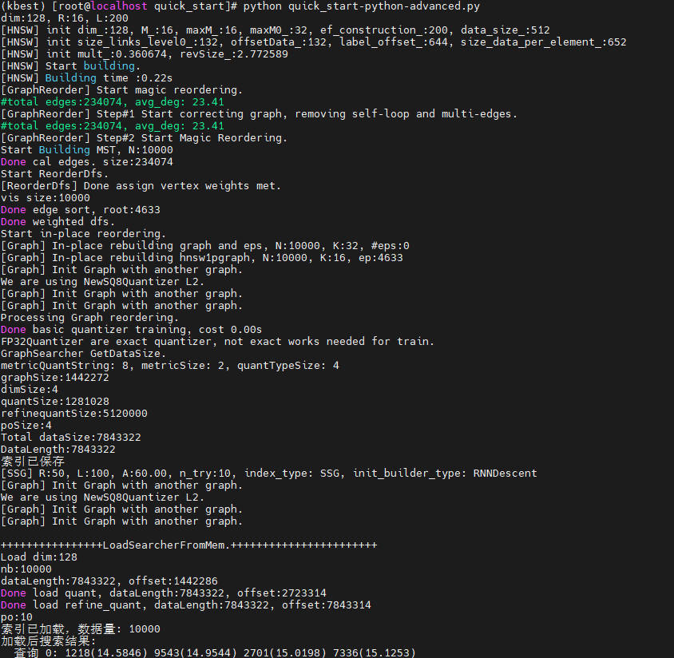
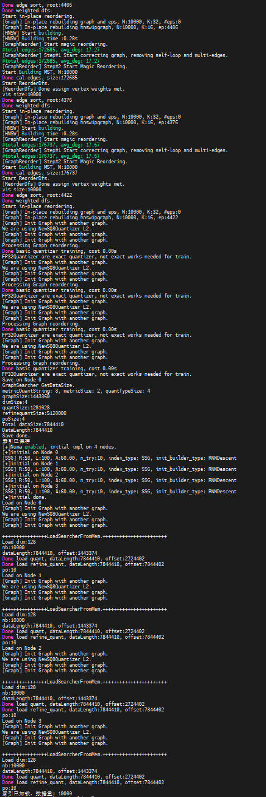

# 快速入门

本文档提供KBest核心功能的快速入门指导，涵盖KBest核心概念、快速入门示例、进阶扩展以及进阶参数调优指导。

## 核心概念

KBest基于图的近似最近邻搜索，其核心是图索引（Graph Index），即通过构建邻居关系图来高效执行相似性搜索的结构：

- 向量：KBest支持float32类型的向量。
- 索引类型：KBest基于图结构实现近似搜索，支持多种邻居选择策略（HNSW、NSG、TSDG、SSG），推荐入门使用HNSW策略。
- 核心流程：创建索引-添加向量并构建图索引-构建检索器-执行相似性搜索

## 快速入门示例

以下是覆盖KBest核心使用场景的完整代码，包含注释和结果解析。

### Python

以Python调用KBest，执行以下命令。

```python
import numpy as np
import kbest

# 1. 准备数据
d = 128                                       # 向量维度
nb = 10000                                    # 底库向量数量
nq = 5                                        # 查询向量数量

np.random.seed(42)
db_vectors = np.random.random((nb, d)).astype(np.float32)     # 底库向量
query_vectors = np.random.random((nq, d)).astype(np.float32)  # 查询向量

# 2. 创建索引
# 参数说明：维度, 邻居数R, 构图候选列表L, 角度阈值A, 图优化迭代次数,
#          距离类型, 构图算法, 邻居策略, NUMA开关, NUMA节点数
index = kbest.KBest(d, 32, 200, 60, 2, "L2", "RNNDescent", "HNSW", False, 1)

# 3. 添加向量并构建图索引
# 参数说明：数据量, 数据, 块大小, 重排开关, 量化等级(0=FP32)
index.add(nb, db_vectors, 16, 1, 0)
print(f"索引中向量数量: {index.getNTotal()}")  # 输出: 10000

# 4. 构建检索器（必须在搜索前调用）
index.buildSearcher()

# 5. 设置检索参数（可选）
index.setEf(100)

# 6. 执行搜索
k = 4                                         # 返回最近的4个向量
distances = np.zeros((nq, k), dtype=np.float32)
indices = np.zeros((nq, k), dtype=np.int64)

index.search(nq, query_vectors, k, distances, indices, 4)

# 7. 结果解析
print("最近邻索引和对应距离:")
for i in range(nq):
    result = " ".join([f"{indices[i,j]}({distances[i,j]:.4f})" for j in range(k)])
    print(f"查询 {i}: {result}")
```

预期结果如下：



### C++

以C++调用KBest，执行以下命令。

```c++
#include <iostream>
#include <vector>
#include <random>
#include "kbest.h"

int main() {
    // 1. 准备数据
    int d = 128;                              // 向量维度
    int nb = 10000;                           // 底库向量数量
    int nq = 5;                               // 查询向量数量

    std::vector<float> db_vectors(nb * d);    // 底库向量
    std::vector<float> query_vectors(nq * d); // 查询向量

    // 随机生成向量数据
    std::mt19937 rng(42);
    std::uniform_real_distribution<float> dist(0.0f, 1.0f);
    for (auto& v : db_vectors) v = dist(rng);
    for (auto& v : query_vectors) v = dist(rng);

    // 2. 创建索引
    // 参数说明：维度=128, 邻居数R=32, 构图候选列表L=200, 角度阈值A=60
    //          图优化迭代次数=2, 距离类型=L2, 构图算法=RNNDescent, 邻居策略=HNSW
    KBest index(d, 32, 200, 60, 2, "L2", "RNNDescent", "HNSW");

    // 3. 添加向量并构建图索引
    // 参数说明：数据量, 数据指针, 块大小=16, 重排=1, 量化等级=0(FP32)
    index.Add(nb, db_vectors.data(), 16, 1, 0);
    std::cout << "索引中向量数量: " << index.GetNTotal() << std::endl;  // 输出: 10000

    // 4. 构建检索器（必须在搜索前调用）
    index.BuildSearcher();

    // 5. 设置检索参数（可选，ef越大精度越高但速度越慢）
    index.SetEf(100);

    // 6. 执行搜索（返回每个查询的k个最近邻）
    int k = 4;                                // 返回最近的4个向量
    std::vector<float> distances(nq * k);     // 存储距离结果
    std::vector<int64_t> indices(nq * k);     // 存储索引结果

    index.Search(nq, query_vectors.data(), k, distances.data(), indices.data(), 4);

    // 7. 结果解析
    std::cout << "最近邻索引和对应距离:" << std::endl;
    for (int i = 0; i < nq; i++) {
        std::cout << "查询 " << i << ": ";
        for (int j = 0; j < k; j++) {
            std::cout << indices[i * k + j] << "(" << distances[i * k + j] << ") ";
        }
        std::cout << std::endl;
    }

    return 0;
}
```

预期结果如下：



## 进阶扩展

进阶示例展示索引持久化、量化加速等功能。

### Python

```python
import numpy as np
import kbest

d = 128
nb = 10000

db_vectors = np.random.random((nb, d)).astype(np.float32)

# ===== 构建索引并使用量化加速 =====
index = kbest.KBest(d, 32, 200, 60, 2, "L2", "RNNDescent", "HNSW", False, 1)

# 量化等级：0=FP32(精度最高), 1=SQ8U, 2=SQ4U, 3=FP16
level = 1  # 使用SQ8U量化
index.add(nb, db_vectors, 16, 1, level)
index.buildSearcher()

# ===== 保存索引到文件 =====
index.save("./kbest_index.bin")
print("索引已保存")

# ===== 加载索引并直接搜索 =====
loaded_index = kbest.KBest(False, 1)          # 加载专用构造(numa_enabled, numa_nodes)
loaded_index.load("./kbest_index.bin")
print(f"索引已加载，数据量: {loaded_index.getNTotal()}")

# 设置检索参数后直接搜索，无需重新构建
loaded_index.setEf(100)
nq, k = 1, 4
query = np.random.random((nq, d)).astype(np.float32)
distances = np.zeros((nq, k), dtype=np.float32)
indices = np.zeros((nq, k), dtype=np.int64)
loaded_index.search(nq, query, k, distances, indices, 4)

print("加载后搜索结果:")
for i in range(nq):
    result = " ".join([f"{indices[i,j]}({distances[i,j]:.4f})" for j in range(k)])
    print(f"  查询 {i}: {result}")
```

预期结果如下：



### C++

```c++
#include <iostream>
#include <vector>
#include "kbest.h"

int main() {
    int d = 128;
    int nb = 10000;

    std::vector<float> db_vectors(nb * d);
    // ... 填充数据 ...

    // ===== 构建索引并使用量化加速 =====
    KBest index(d, 32, 200, 60, 2, "L2", "RNNDescent", "HNSW");

    // 量化等级：0=FP32(精度最高), 1=SQ8U, 2=SQ4U, 3=FP16
    int level = 1;  // 使用SQ8U量化，平衡性能与精度
    index.Add(nb, db_vectors.data(), 16, 1, level);
    index.BuildSearcher();

    // ===== 保存索引到文件 =====
    index.Save("./kbest_index.bin");
    std::cout << "索引已保存" << std::endl;

    // ===== 加载索引并直接搜索 =====
    KBest loaded_index;                       // 无参构造
    loaded_index.Load("./kbest_index.bin");   // 加载检索器
    std::cout << "索引已加载，数据量: " << loaded_index.GetNTotal() << std::endl;

    // 设置检索参数后直接搜索，无需重新构建
    loaded_index.SetEf(100);
    int nq = 1, k = 4;
    std::vector<float> query(d), distances(k);
    std::vector<int64_t> indices(k);
    loaded_index.Search(nq, query.data(), k, distances.data(), indices.data(), 4);

    return 0;
}
```

预期结果如下：



## 进阶参数调优指导<a name="ZH-CN_TOPIC_0000002522066588"></a>

本章节提供KBest接口相关参数的进阶调优指导，该调优指导同时适用于C++接口与Python接口。

**构造函数接口<a name="section8200133234918"></a>**

<a name="table1366255115497"></a>

| 参数名称 | 参数取值范围 | 推荐值 | 调优说明 |
| --- | --- | --- | --- |
| R | [11,499] | 50 | 邻居节点数，影响图构建耗时和最终索引质量，一般推荐使用50，过大可能会导致构建耗时过长以及搜索性能下降，过小则会影响检索精度。 |
| L | [11,1999] | 100,200 | 构图时的候选节点列表大小，影响图构建耗时和最终索引质量，一般推荐使用100，过大可能会导致构建耗时过长。 |
| A | [1,360] | 60,120 | 构图剪枝时的角度阈值，对于IP数据集，一般使用120，L2数据集一般使用60。 |
| graph_opt_iter | [0,30] | 29 | 图索引自我迭代的轮数，过大可能导致构建耗时过长。 |

**Add接口<a name="section9524192295015"></a>**

<a name="table13386938135011"></a>

| 参数名称 | 参数取值范围 | 推荐值 | 调优说明 |
| --- | --- | --- | --- |
| level | [0,3] | 1,2 | 控制量化的等级，level 1代表SQ8U量化，level 2代表SQ4U量化。对于IP数据集，一般使用1，L2数据集使用2。 |

**SetEf接口<a name="section2981160145118"></a>**

<a name="table133713875113"></a>

| 参数名称 | 参数取值范围 | 调优说明 |
| --- | --- | --- |
| ef | [1, nb]，其中<span class="parmname" id="parmname336535516614"><a name="parmname336535516614"></a>“nb”</span>为向量底库数据量大小。 | 检索时的候选节点列表大小，对于小规模数据集，一般在10~500左右。更大的ef会带来更高的检索精度，但是检索性能也会降低。建议在精度达标情况下ef取较小值。 |

**SetEarlyStoppingParams接口<a name="section158341126132613"></a>**

<a name="table158341026202611"></a>

| 参数名称 | 参数取值范围 | 调优说明 |
| --- | --- | --- |
| adding_pref | 大于等于1 | 用于检索时早停机制，表示候选节点插入阈值，检索过程中节点插入候选集的位置大于adding_pref表示其远离查询节点，后续检索到答案的可能较低。较小的adding_pref能提高检索效率，但是检索精度也会降低。 |
| patience | 大于等于1 | 检索时早停机制，表示插入位置靠后或者插入失败的耐心值，当连续插入位置大于阈值adding_pref的次数超过耐心值时，检索结束。较小的patience能提高检索效率，但是检索精度也会降低。 |

## 修订记录

|文档版本|发布日期|修改说明|
|--|--|--|
|01|2025-12-30|第一次正式发布。|
